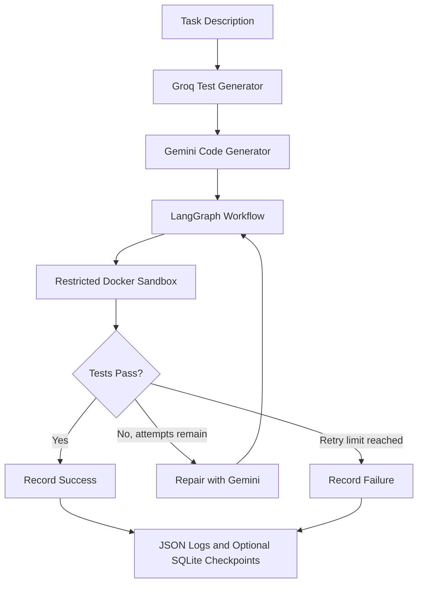

# Multi-Agent Coding Assistant

A multi-agent coding system that uses **Google Gemini** to generate Python solutions and **Groq GPT-OSS-120B** to independently generate test cases. A **LangGraph workflow** orchestrates execution in a restricted Docker sandbox, feeds failures back into a repair loop, and records task execution results.

[Live Demo](https://multi-agent-coding-assistant-9mreb4hcxzwjaximxgf8d4.streamlit.app/) · [GitHub Repository](https://github.com/vishal0205/multi-agent-coding-assistant)

## Key Features

- **Independent code and test generation:** Uses Gemini for solution generation and Groq for independently generated test assertions.
- **Graph-based agent orchestration:** Uses LangGraph to manage test generation, code generation, execution, repair, and completion.
- **Iterative code repair:** Feeds execution failures back to the code generator, with a maximum of five execution attempts.
- **Restricted code execution:** Runs generated Python code in Docker with network isolation, resource limits, and restricted container permissions.
- **Fail-closed execution:** Does not fall back to executing generated code directly on the host when Docker or the required sandbox image is unavailable.
- **Execution history:** Records task attempts, generated code, test code, execution output, and results in JSON logs.
- **Workflow checkpointing:** Supports SQLite-backed LangGraph checkpoints for persistent workflow state.
- **Interactive UI:** Provides a Streamlit interface for submitting coding tasks and reviewing generated solutions and execution results.
- **Automated testing:** Includes pytest tests and sandbox safety checks, with GitHub Actions CI configured in the repository.

## Architecture



## How It Works

1. **Task submission:** The user provides a Python coding problem.
2. **Test generation:** Groq generates test assertions for the requested task.
3. **Solution generation:** Gemini generates a Python solution following the expected `solution()` interface.
4. **Sandboxed execution:** The solution and generated tests are executed in the configured Docker environment.
5. **Failure analysis:** If execution fails, the workflow captures the failure output and sends feedback to Gemini for a revised solution.
6. **Retry control:** The workflow repeats execution and repair until the tests pass or the maximum attempt limit is reached.
7. **Result recording:** The system records execution results and attempt history. SQLite-backed checkpointing is available for workflow state persistence.

Using different model providers for code and test generation encourages independent reasoning, but does not guarantee that generated tests are complete or correct.

## Sandbox Security

Generated code must be treated as untrusted input. The local Docker execution path uses container restrictions that include:

- Network isolation using `--network none`
- Memory and CPU limits
- Process-count limits
- A read-only container filesystem
- Dropped Linux capabilities
- `no-new-privileges`
- A non-root user (`UID 10001`)
- A read-only bind mount for the generated script
- Execution timeouts and container termination handling

**Fail-closed behavior:** If Docker is unavailable or the expected sandbox image cannot be inspected, the application reports an execution failure rather than running generated code directly on the host.

These controls reduce risk but do not guarantee protection against every container escape or host-level vulnerability. Use the application only within an appropriately configured isolation boundary.

## Benchmark Results

The project includes a custom benchmark of 12 Python coding tasks, including palindrome checks, FizzBuzz, LRU cache, and topological sort.

| Metric | Recorded result |
|---|---:|
| Tasks passed | 12/12 |
| Average execution attempts per task | 1.0 |

In the recorded benchmark run, all 12 tasks passed on the first attempt. This result applies only to the selected task set and does not establish general coding accuracy.

The benchmark also does not measure the overall success rate of the repair loop after failures. The repair path was exercised separately during development.

Run the benchmark locally:

```bash
python run_benchmark.py
```

The benchmark writes per-task JSON results under `logs/` and uses SQLite-backed workflow checkpoints under `checkpoints/`.

## Technology Stack

| Category | Technologies |
|---|---|
| Language | Python |
| Code generation | Google Gemini API |
| Test generation | Groq API, `openai/gpt-oss-120b` |
| Agent orchestration | LangGraph |
| Workflow checkpointing | SQLite, LangGraph checkpointing |
| Code execution | Docker |
| User interface | Streamlit |
| Execution records | JSON logs |
| Testing | pytest, sandbox safety checks |
| Continuous integration | GitHub Actions |

## Getting Started

### Prerequisites

- Python 3.11
- Docker Desktop or a working Docker Engine
- Google Gemini API key
- Groq API key
- Git

### 1. Clone the repository

```bash
git clone https://github.com/vishal0205/multi-agent-coding-assistant.git
cd multi-agent-coding-assistant
```

### 2. Create and activate a virtual environment

**Windows PowerShell**

```powershell
python -m venv venv
.\venv\Scripts\Activate.ps1
```

**macOS/Linux**

```bash
python -m venv venv
source venv/bin/activate
```

### 3. Install dependencies

```bash
python -m pip install -r requirements.txt
```

### 4. Configure API keys

Create a `.env` file in the project root:

```dotenv
GEMINI_API_KEY=your_gemini_api_key
GROQ_API_KEY=your_groq_api_key
```

Replace the placeholders with your own API keys. Keep `.env` private and never commit real credentials to GitHub.

### 5. Build the Docker sandbox image

Ensure Docker is running, then execute:

```bash
docker build -t coding-agent-sandbox:latest .
```

The application expects the configured sandbox image to be available before generated code can execute.

### 6. Launch the application

```bash
streamlit run streamlit_app.py
```

Open the local URL displayed by Streamlit in your browser.

### 7. Run the benchmark

```bash
python run_benchmark.py
```

### 8. Run the test suite

```bash
python -m pytest -q
```

To run the sandbox safety checks separately:

```bash
python test_sandbox_safety.py
```

## Known Limitations

- **Limited benchmark coverage:** The 12-task benchmark is a small, self-built evaluation set and is not representative of all coding problems.
- **Generated test quality:** Tests may miss edge cases or contain incorrect assumptions.
- **Model dependency:** Generation and repair depend on external API availability, quotas, credentials, and model behavior.
- **Docker requirement:** Generated code is not executed when Docker or the expected sandbox image is unavailable.
- **Cost tracking:** Per-task API cost and token-usage tracking are not currently implemented.
- **Execution security:** Container restrictions reduce risk but cannot eliminate every possible security vulnerability.
- **Deployment:** The project has a linked Streamlit demo; a separate hosted FastAPI application and hosted execution sandbox are not claimed as implemented.

## Future Improvements

- Expand the benchmark with harder coding problems and edge cases.
- Add explicit code-generation, test-generation, and sandbox execution latency metrics.
- Track token usage and estimated API costs.
- Evaluate generated test quality and coverage.
- Add structured tracing and observability for graph nodes and repair attempts.
- Explore MCP-based tool integration and a dedicated hosted execution sandbox.
- Make model configuration more flexible across providers.

## Project Goals

This project explores practical agent engineering concepts: independent model roles, graph-based orchestration, bounded retry loops, execution feedback, container isolation, automated testing, and workflow state management.