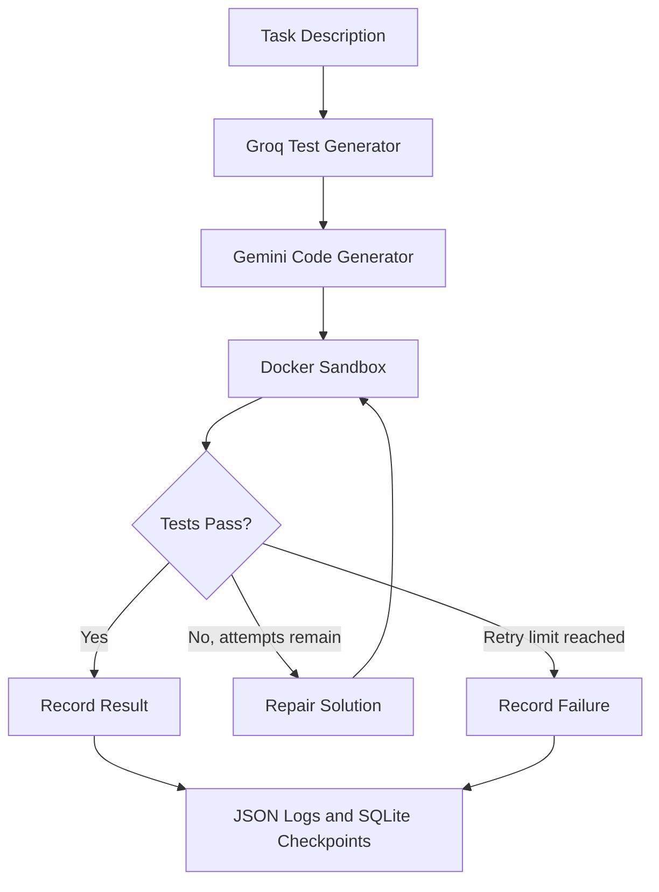

# Multi-Agent Coding Assistant

A multi-agent coding system that uses **Google Gemini** to generate Python solutions and **Groq GPT-OSS-120B** to independently generate tests. A **LangGraph workflow** executes the solution in a restricted Docker sandbox, retries failed solutions with feedback, and records execution history with persistent SQLite checkpoints.

**[Live Demo](https://multi-agent-coding-assistant-9mreb4hcxzwjaximxgf8d4.streamlit.app/)** · **[GitHub Repository](https://github.com/vishal0205/multi-agent-coding-assistant)**

## Key Features

- **Independent code and test generation:** Gemini generates solutions while Groq generates test assertions independently.
- **Iterative code repair:** A supervisor workflow feeds execution failures back to the coder for up to five attempts.
- **LangGraph orchestration:** Models task execution as a graph with generation, execution, repair, and completion stages.
- **Persistent checkpoints:** Uses SQLite-backed LangGraph checkpointing to persist workflow state by task ID.
- **Sandboxed execution:** Runs generated code in Docker with network isolation, resource limits, a read-only filesystem, dropped capabilities, an unprivileged user, and execution timeouts.
- **Execution history:** Records generated code, tests, attempt results, and execution output in JSON logs.
- **Interactive interface:** Streamlit UI for submitting tasks and viewing generated tests, solutions, and attempt history.
- **Automated checks:** GitHub Actions builds the sandbox image, runs sandbox safety checks, and checks Python syntax. See the CI workflow for the exact checks configured on the current branch.

## Architecture



## How It Works

1. **Generate tests:** Groq generates test assertions for the requested Python task.
2. **Generate code:** Gemini generates a solution using the shared `solution()` function interface.
3. **Execute safely:** The generated solution and tests run in the configured Docker sandbox.
4. **Repair failures:** Failed executions return error output to Gemini, which generates a corrected solution. The workflow permits up to five execution attempts.
5. **Persist results:** The workflow records attempt history and execution duration, while LangGraph checkpointing stores workflow state in SQLite.

The test generator and code generator use different model providers to reduce the risk of both agents sharing the same assumptions. Generated tests are not a guarantee of correctness; benchmark results depend on the selected tasks and generated assertions.

## Sandbox Security

Generated code is untrusted, so the local execution path uses a restricted Docker container with:

- Network disabled (`--network none`)
- Memory and CPU limits
- Process-count limit
- Read-only container filesystem
- Dropped Linux capabilities
- `no-new-privileges`
- Unprivileged user (`UID 10001`)
- A read-only bind mount for the generated script
- Execution timeout and container termination handling

**Fail-closed behavior:** If Docker is unavailable or the sandbox image cannot be inspected, the application does not execute generated code on the host. Execution returns a sandbox error instead.

The sandbox reduces risk but should not be considered a guarantee against every possible container escape or host-level threat. Do not run untrusted generated code outside the configured isolation boundary.

## Benchmark Results

The project includes a custom benchmark of 12 Python coding tasks, including palindrome checks, FizzBuzz, LRU cache, and topological sort.

| Metric | Result |
|---|---:|
| Tasks solved | 12/12 |
| Average execution attempts per task | 1.0 |

In this recorded run, all 12 tasks passed on the first attempt. Therefore, this benchmark demonstrates first-attempt success on the selected task set; it does **not** measure how frequently the repair loop succeeds after failures. The repair path was separately exercised during development when an agent interface mismatch required a second attempt.

To run the benchmark locally:

```bash
python run_benchmark.py
```

The benchmark writes per-task JSON results under `logs/` and uses SQLite-backed workflow checkpoints under `checkpoints/`.

## Technology Stack

- **Language:** Python
- **Code generation:** Google Gemini API
- **Test generation:** Groq API with `openai/gpt-oss-120b`
- **Agent orchestration:** LangGraph
- **Checkpointing:** SQLite and LangGraph checkpointing
- **Sandbox:** Docker
- **UI:** Streamlit
- **Logging:** JSON task logs
- **Testing:** pytest and sandbox safety checks
- **CI:** GitHub Actions

## Run Locally

### Prerequisites

- Python 3.11
- Docker Desktop or a working Docker Engine
- Gemini API key
- Groq API key

### 1. Clone the repository

```bash
git clone https://github.com/vishal0205/multi-agent-coding-assistant.git
cd multi-agent-coding-assistant
```

### 2. Create and activate a virtual environment

Windows PowerShell:

```powershell
python -m venv venv
.\venv\Scripts\Activate.ps1
```

macOS/Linux:

```bash
python -m venv venv
source venv/bin/activate
```

### 3. Install dependencies

```bash
python -m pip install -r requirements.txt
```

### 4. Configure API keys

Create a `.env` file in the project root:

```dotenv
GEMINI_API_KEY=your_gemini_api_key
GROQ_API_KEY=your_groq_api_key
```

Keep `.env` private. Never commit real API keys to GitHub.

### 5. Build the sandbox image

Start Docker, then run:

```bash
docker build -t coding-agent-sandbox:latest .
```

The application expects Docker and the sandbox image to be available for generated-code execution.

### 6. Launch the application

```bash
streamlit run streamlit_app.py
```

### 7. Run the benchmark

In a separate terminal with the environment activated:

```bash
python run_benchmark.py
```

### 8. Run automated tests

```bash
python -m pytest -q
```

The sandbox safety script can also be run with:

```bash
python test_sandbox_safety.py
```

## Known Limitations

- **Benchmark scope:** The 12-task benchmark is a small, self-built evaluation set and does not establish general coding accuracy.
- **Generated test quality:** Independently generated tests can still miss edge cases or encode incorrect assumptions.
- **Model and API limits:** Execution depends on provider availability, quotas, model behavior, and API credentials.
- **Docker dependency:** Generated code is not executed if Docker or the expected sandbox image is unavailable.
- **Cost and latency metrics:** Per-task API cost tracking is not currently implemented.

## Future Improvements

- Add per-task token usage, API cost, and end-to-end latency metrics.
- Expand the benchmark with harder tasks and additional edge cases.
- Evaluate generated tests for coverage and quality.
- Add more structured tracing for workflow nodes and repair attempts.
- Explore additional model providers through configurable model settings.
